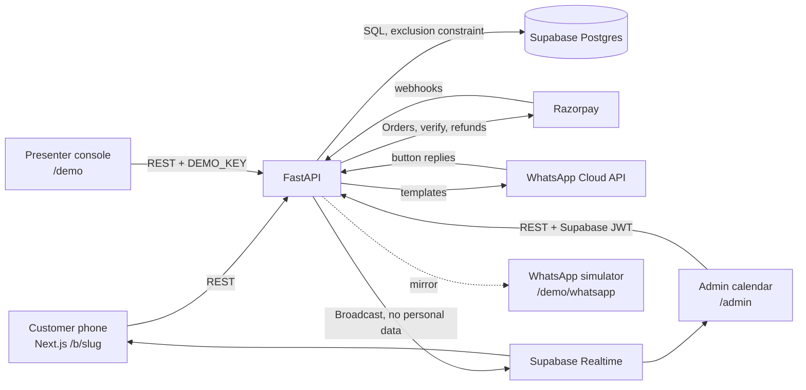

# SlotPay

Online booking with an advance payment for the fictional **Glow Studio Salon & Spa, Thane West** (Neovia AI · Demo 05). A customer books on their phone, pays a small advance through Razorpay (test mode), receives a WhatsApp confirmation, and the booking appears live on the admin calendar. Built for a 3-minute live sales demo.

- Double booking is impossible at the **database** level (Postgres exclusion constraint).
- A booking confirms only after **server-side payment verification**.
- Money is integer paise; prices are GST-inclusive; timestamps are UTC, shown in Asia/Kolkata.

## Prototype: everything as ONE website

One command starts the database, API and web app and serves **everything from a single address, `http://localhost:3100`**:

```powershell
# Windows (set PY to the Python that has api/requirements.txt installed)
$env:PY = "C:\path	o\python.exe"; powershell -ExecutionPolicy Bypass -File scripts\prototype.ps1
```
```bash
# macOS / Linux / Git Bash
scripts/prototype.sh        # or: make prototype
```

- **`/prototype`** is the hub: cards for the customer site, booking, admin calendar, reports, presenter console and WhatsApp simulator, with live data counts, a 3-minute walkthrough, a role switch and Reset.
- A floating **Prototype** button on every page jumps anywhere and switches between **Owner** and **Front desk**.
- **No manual steps:** the admin signs in automatically (the API issues a short-lived demo token), and the presenter console and simulator use the demo key by default.
- **One origin:** the browser only talks to `localhost:3100`; the web app proxies `/api/*` to the FastAPI server (port 8000 stays internal). No CORS, one URL to share.
- How it works: the web app is built with `NEXT_PUBLIC_PROTOTYPE=1`, `NEXT_PUBLIC_API_BASE_URL=/api`, `API_INTERNAL_URL=http://localhost:8000`; the API runs with `PROTOTYPE_MODE=true` (+ `DEMO_MODE=true`, `SUPABASE_JWT_SECRET`). **Demo use only:** prototype mode lets anyone who can reach the site log in as staff and reset data. Never enable it for a real salon.
- Payments: with no Razorpay keys the prototype uses a simulated checkout; add Razorpay **test** keys to the API to use the real one.

## The working journey: book, pay, WhatsApp, reminders

In prototype mode the whole story runs end to end with no external accounts:

1. **Book** at `/b/glow-studio` (service, stylist, time, details).
2. **Pay:** with no Razorpay keys the API uses a built-in mock, and the page shows a simulated checkout (`success@razorpay` pays, `failure@razorpay` shows the retry state). It runs the same `confirm_booking()`, refund and audit code as real Razorpay.
3. **WhatsApp confirmation** is sent the moment payment is confirmed. On the confirmation page a live phone shows it arriving (with a notification banner).
4. **Reminders** (24 h and 2 h) are scheduled with Reschedule / Cancel buttons. In the prototype they arrive **20 s and 40 s** after booking (`REMINDER_DEMO_DELAY_SEC`, default 20 in the launcher) so you can watch them; with the setting at `0` they follow the real appointment time.
5. **Cancel** on WhatsApp cancels the booking, refunds the advance and replies in chat. The calendar, the booking page and the presenter timeline all update.
6. The booking shows up on the **admin calendar** (live toast for new online bookings) and in the **WhatsApp simulator** (`/demo/whatsapp`).

An automated browser test (`web/e2e/journey.spec.ts`) covers this whole path.

### Sending to a real WhatsApp number

The messages are real WhatsApp Cloud API payloads, but the simulator is the default because sending to a phone needs your own Meta account. To send to a real number:

1. In Meta for Developers, create an app with the **WhatsApp** product and note the **Phone number ID** and a **permanent access token** (System User token).
2. Add your own phone under *API Setup → To* and verify it (the test number can only message numbers you add, up to 5).
3. Submit the three Utility templates from the build prompt and wait for approval: `slotpay_booking_confirmed`, `slotpay_appointment_reminder` (quick replies **Reschedule** then **Cancel**), `slotpay_booking_cancelled`.
4. Start the API with `WHATSAPP_MODE=both` (real + simulator mirror), `WHATSAPP_PHONE_NUMBER_ID`, `WHATSAPP_ACCESS_TOKEN`, `WHATSAPP_APP_SECRET`, `WHATSAPP_VERIFY_TOKEN`, and point Meta's webhook at `https://<your-public-url>/api/webhooks/whatsapp` (use a tunnel such as cloudflared locally).
5. Make a booking with **your verified number** and tick the WhatsApp opt-in. The customer must be opted in (`whatsapp_opt_in`) for live sends.

Not verified from this repository: live delivery to a real phone (needs your credentials). Everything up to the Cloud API request is covered by tests and the simulator.

## Architecture



| Folder | Contents |
|---|---|
| `web/` | Next.js (App Router, TypeScript, Tailwind): booking page, confirmation, policy pages, admin, presenter console, simulator. Playwright tests in `web/e2e`. |
| `api/` | FastAPI: availability engine, holds, Razorpay, messaging, admin, reports, demo. pytest in `api/tests`. |
| `supabase/` | `migrations/*.sql` (schema, RLS, overlap guard) and `seed/seed.py` (idempotent demo data). |
| `scripts/` | `migrate.py`, `dev_token.py` (dev-only admin token), `dev.ps1` (Windows task runner). |
| `docs/` | `DECISIONS.md`, `DEMO_SCRIPT.md`, `BUILD_PROMPT.md`, `SCOPE.md` (when added). |

## Local setup

Prerequisites: Docker, Python 3.11+, Node 20+ (Chrome for Playwright).

```bash
# 1. Postgres 16 in Docker (port 54322)
make db-up                       # Windows without make: scripts/dev.ps1 db-up

# 2. API
python -m venv .venv && . .venv/bin/activate     # use a SHORT path on Windows
pip install -r api/requirements-dev.txt
cp api/.env.example api/.env     # fill values (see table below)
make seed                        # migrates + seeds demo data (about 1-2 s)
python api/run.py                # http://localhost:8000/health

# 3. Web
cd web && cp .env.example .env.local && npm install && npm run dev
```

Open `http://localhost:3000/b/glow-studio`. On Windows run the API with `python api/run.py` (not `uvicorn app.main:app`): psycopg's async mode needs the selector event loop.

### Tests

```bash
make test                # 127 API tests against real Postgres (creates/drops slotpay_test)
make concurrency-test    # the 20-concurrent-holds test
cd web && npx playwright test    # mobile e2e (uses installed Chrome; API + web are started automatically)
```

## Environment variables

**api/.env** (server only)

| Variable | Purpose |
|---|---|
| `DATABASE_URL` | Postgres connection string (Supabase direct or pooler) |
| `SUPABASE_URL`, `SUPABASE_SERVICE_ROLE_KEY` | Realtime broadcast + creating Auth users in the seed |
| `SUPABASE_JWKS_URL` **or** `SUPABASE_JWT_SECRET` | Verifies admin tokens (use whichever your project uses) |
| `WEB_ORIGIN` | CORS allow-list (the web app's origin) |
| `PUBLIC_BASE_URL` | Public web URL (QR code, message links) |
| `JOBS_SECRET` | Protects `POST /internal/jobs/tick` (header `x-jobs-secret`) |
| `DEMO_KEY` | Protects `/demo/*` and the simulator |
| `PROTOTYPE_MODE` | `true` enables the one-click staff login and hub data (`/prototype/*`). Demo only; default `false` |
| `DEMO_MODE` | `true` allows the destructive Reset buttons (demo deployments only; default `false`) |
| `TRUST_PROXY` | `true` (default) reads the customer IP from `X-Forwarded-For` for rate limits; set `false` if the API is exposed directly |
| `RAZORPAY_KEY_ID`, `RAZORPAY_KEY_SECRET`, `RAZORPAY_WEBHOOK_SECRET` | Razorpay **test mode** |
| `WHATSAPP_MODE` | `simulator` (default), `live`, or `both` |
| `WHATSAPP_PHONE_NUMBER_ID`, `WHATSAPP_ACCESS_TOKEN`, `WHATSAPP_APP_SECRET`, `WHATSAPP_VERIFY_TOKEN` | WhatsApp Cloud API |
| `WHATSAPP_TEMPLATE_CONFIRMED` / `_REMINDER` / `_CANCELLED` | Template names (defaults `slotpay_booking_confirmed`, `slotpay_appointment_reminder`, `slotpay_booking_cancelled`) |

**web/.env.local** (browser-safe values only)

| Variable | Purpose |
|---|---|
| `NEXT_PUBLIC_API_BASE_URL` | API URL |
| `NEXT_PUBLIC_SUPABASE_URL`, `NEXT_PUBLIC_SUPABASE_ANON_KEY` | Supabase client (Auth, Realtime) |
| `NEXT_PUBLIC_RAZORPAY_KEY_ID` | Optional; the key id also arrives with each order |
| `NEXT_PUBLIC_PROTOTYPE`, `NEXT_PUBLIC_DEMO_KEY` | `1` + the demo key turn on the hub, dock and auto-login (prototype builds only) |
| `API_INTERNAL_URL` | Server-side address of the API (used for page data and the `/api` proxy). Default `http://localhost:8000` |
| `NEXT_PUBLIC_DEV_AUTH` | **Dev only** (`1` shows a dev-token login). Never set in production. |

## Razorpay test webhooks

1. Put the **Test Mode** keys in `api/.env` and enable auto-capture in the test dashboard.
2. Expose the API (`cloudflared tunnel --url http://localhost:8000`) or use the deployed URL.
3. Dashboard → Webhooks → add `https://<api>/webhooks/razorpay` with events `payment.captured`, `payment.failed`, `refund.processed`, `refund.failed`; copy the secret into `RAZORPAY_WEBHOOK_SECRET`.
4. In Checkout choose UPI and enter `success@razorpay` (or `failure@razorpay` for the retry state). Real UPI apps cannot pay a test order.

## WhatsApp

- `WHATSAPP_MODE=simulator` needs nothing: open `/demo/whatsapp?phone=<10 digits>&key=<DEMO_KEY>`.
- Live: submit three **Utility**, English templates in WhatsApp Manager (templates must not start or end with a variable):
  - `slotpay_booking_confirmed` — "Hi {{1}}, your {{2}} with {{3}} at {{4}} is confirmed for {{5}}. Advance paid: ₹{{6}}. Balance is payable at the salon. Booking ID: {{7}}. See you soon!" with a URL button "View booking" (dynamic suffix).
  - `slotpay_appointment_reminder` — "Hi {{1}}, a reminder that your {{2}} at {{3}} is {{4}} at {{5}}. Free cancellation is available until {{6}}. Tap a button below if your plans change." with quick replies **Reschedule**, then **Cancel** (in that order).
  - `slotpay_booking_cancelled` — "Hi {{1}}, your booking {{2}} has been cancelled. {{3}} Thank you for letting us know."
- Meta webhook callback: `https://<api>/webhooks/whatsapp`, verify token = `WHATSAPP_VERIFY_TOKEN`, subscribe to `messages`.
- The test number only reaches recipients you add and verify (up to 5) in API Setup. Use `both` mode to also mirror into the simulator.

## Deployment

The API needs an **always-on** instance (webhooks and the 60-second job loop must not sleep).

1. **Database:** create a Supabase project; copy the Postgres connection string and API keys. Migrations run automatically when the API container starts.
2. **API (Render, Railway or Fly):** `Dockerfile` (build context = repo root) and `render.yaml` are included. Set the variables above. Health check: `/health`. After the first deploy run the seed once: open the presenter console and press **Reset demo** (or `python supabase/seed/seed.py` with `SUPABASE_URL` and the service key set so real Auth users are created).
3. **Web (Vercel):** import the repo with root directory `web`; set the `NEXT_PUBLIC_*` variables and `NEXT_PUBLIC_API_BASE_URL`. Set the API's `WEB_ORIGIN` and `PUBLIC_BASE_URL` to the Vercel URL.
4. Add the Razorpay and WhatsApp webhooks pointing at the API URL (above).
5. Optional external cron: `POST /internal/jobs/tick` with `x-jobs-secret` (the API also runs it every minute itself).

## Demo credentials (demo only)

Created in Supabase Auth by the seed when `SUPABASE_URL` and the service key are set:

| Role | Email | Password |
|---|---|---|
| Owner | `owner@glowstudio.demo` | `GlowDemo#2026` |
| Front desk | `frontdesk@glowstudio.demo` | `GlowDemo#2026` |

Front desk can use the calendar, bookings and blocks. Only the owner can edit services, prices, staff, settings, see reports, override refunds, or reset the demo (reset also needs `DEMO_MODE=true`). Seed phone numbers are `+91 99999 000NN` (obviously fake). Change these credentials before any non-demo use.

Local shortcut without Supabase: set `NEXT_PUBLIC_DEV_AUTH=1`, run `SUPABASE_JWT_SECRET=... python scripts/dev_token.py owner`, and paste the token via "Use dev token" on `/admin/login`.

## Presenter console

`/demo?key=<DEMO_KEY>`: QR code and link to the booking page, a live event timeline (slot held → order created → checkout opened → signature verified → webhook → confirmed → WhatsApp sent → reminders scheduled), and buttons for reminders, expiring holds, the 20-way double-booking test and reset. See `docs/DEMO_SCRIPT.md`.

## Known limits

- Payments, live WhatsApp and Supabase Auth/Realtime were not exercised against the real services in development; tests use fakes and the simulator. Verify with your own keys using the steps above.
- Customer self-serve reschedule is not built; the WhatsApp "Reschedule" link opens a page asking the customer to call the salon. Admins can reschedule from the calendar.
- Policy pages are templates; the business must review them before going live.
- Rate limits are in-memory (single instance).
